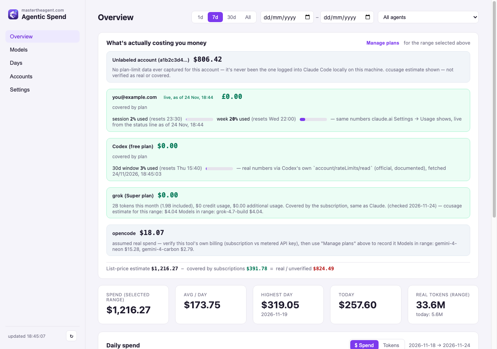
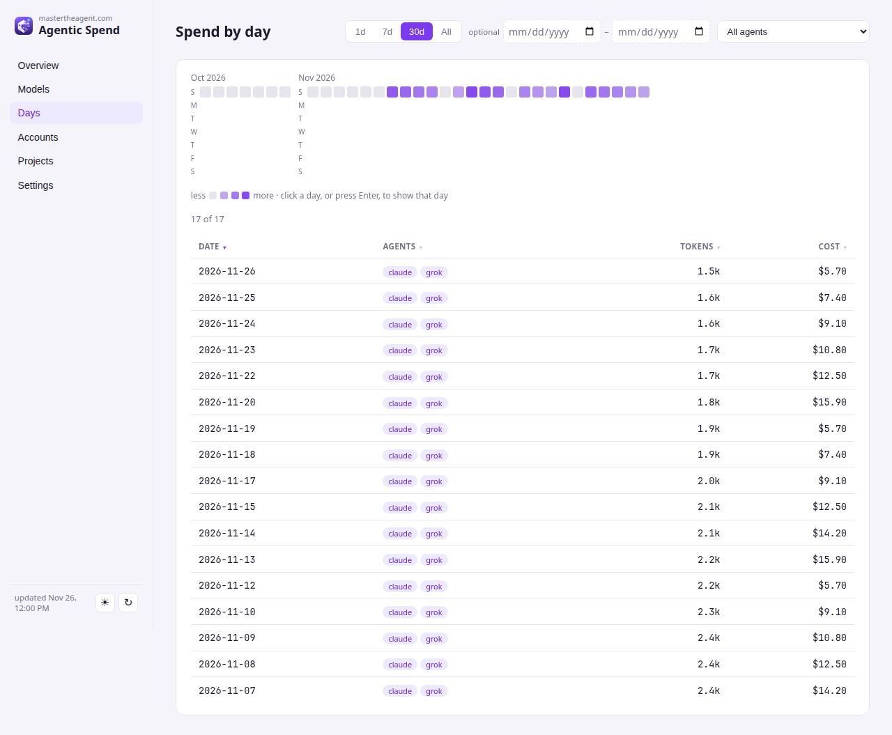
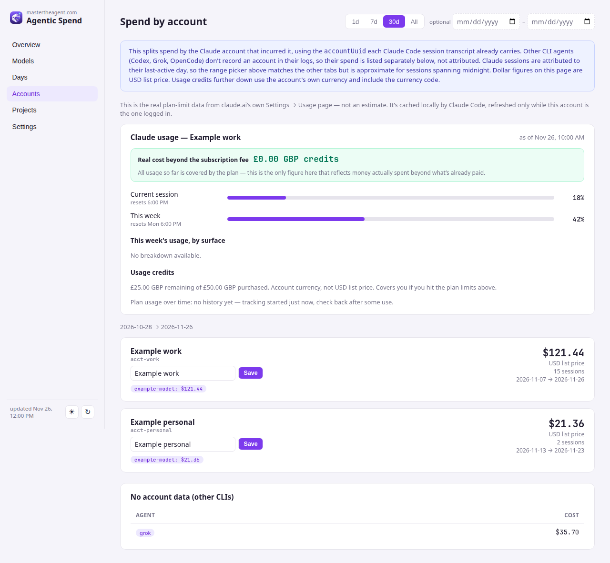
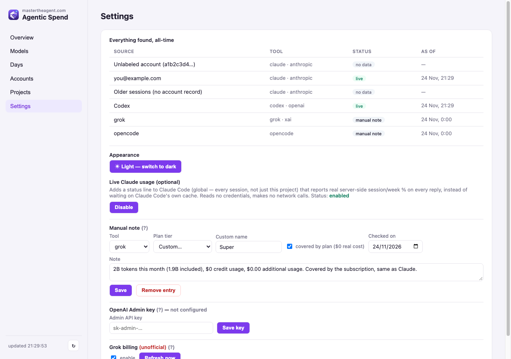

# Agentic Spend

A local-only dashboard for Claude Code / Grok / Codex / OpenCode / etc. spend, built on top of
[`ccusage`](https://ccusage.com). Branded for mastertheagent.com but fully generic — no
hardcoded personal data lives in the code, only in gitignored local data files.

## Screenshots

(Figures below are from a real run with the account/email placeholdered out.)

**Overview** — what's actually costing money vs. covered by a subscription:



**Days** — a calendar heatmap, click a day to filter:



**Accounts** — real plan-limit usage per Claude account, live from the status line:



**Settings** — every source Agentic Spend found, theme toggle, live-usage setup:



## Install

```bash
brew tap tjorourke/agentic-spend
brew install agentic-spend
```

If Homebrew refuses to load the formula ("untrusted tap"), run
`brew trust --formula tjorourke/agentic-spend/agentic-spend` and install again (same as
[flightbay](https://github.com/tjorourke/flightbay)).

## Run it

```bash
agentic-spend          # starts the server (if not already running) and opens the browser
```

Binds to `127.0.0.1:8787` only — nothing here leaves the machine except the optional OpenAI
Costs API call (see below). For local development instead of the brew install: `python3
server.py` from this repo, then open `http://127.0.0.1:8787/`.

### Upgrading

```bash
brew update && brew upgrade agentic-spend
```

(Maintainer only, to cut a new release: tag `vX.Y.Z`, push it, download the tagged
`.tar.gz` from GitHub, `shasum -a 256` it, and update `Formula/agentic-spend.rb`'s
`url`/`sha256`/`version` to match before committing and pushing the formula.)

## Live Claude usage (optional, recommended)

Self-service from the UI: Overview → "Manage plans" → "Live Claude usage" → **Enable**. No file
editing needed. Under the hood it's Anthropic's own documented status line mechanism
(https://code.claude.com/docs/en/statusline): `statusline.py` (in this repo) gets wired into
`~/.claude/settings.json`'s `"statusLine"` — this is global, every Claude Code session on the
machine, not just this project — and Claude Code feeds it real, server-reported
`rate_limits.five_hour`/`seven_day` (% used + reset time) on every reply, for Pro/Max/Ultra
accounts. The script prints a useful status line (cwd/model/5h%/7d%) AND, as a side effect,
writes that data to `~/.claude/cc-usage-live/<accountUuid>.json` (mode 0600). `account_usage.py`'s
`get_max_usage_snapshots()` reads that directory and prefers it over the cached
`cachedUsageUtilization` snapshot whenever it's present — shown in the UI as a green "live, as
of \<time\>" pill instead of the amber "cached \<time\>" one.

**If you already have your own status line configured**, Enable wraps it rather than replacing
it — your existing status line keeps showing exactly as before (via
`AGENTIC_SPEND_WRAP_STATUSLINE`), with the live-usage side effect just added on top. The
original config is backed up to `.statusline-backup.json` (gitignored) and restored exactly by
clicking **Disable**, which never touches a status line this project didn't set.

No credentials are read and no network calls are made by the script — it only reads what Claude
Code already pipes to it on stdin. Limitation: it only updates while that account's Claude Code
session is active and getting replies; an idle/switched-away account falls back to the cached
snapshot (or nothing, if neither exists).

## Live Codex usage (automatic, no setup)

Same trust tier as Claude — fully official and documented, shown automatically whenever `codex`
spend exists, no toggle or key needed. `provider_usage.get_codex_live_snapshot()` spawns
`codex app-server` and calls its documented `account/rateLimits/read` JSON-RPC method (confirmed
against OpenAI's own `codex app-server generate-json-schema` output), one-shot, no persistent
session. Cached 60s server-side (spawning a process has real overhead) and bypassed on a manual
refresh. Field names are camelCase (`usedPercent`/`windowDurationMins`/`resetsAt`) — note this if
cross-referencing OpenAI's docs, some third-party write-ups get this wrong.

## Live Grok usage (optional, unofficial)

Off by default — enable from the same "Manage plans" modal, Section 3. Unlike Claude/Codex, no
documented API exists for Grok's SuperGrok plan at all. `provider_usage.fetch_grok_billing()`
tries `grok agent stdio`'s undocumented `_x.ai/billing` method first (the `grok` CLI handles its
own login, so this code never reads a token), falling back to a direct HTTP call using the token
in `~/.grok/auth.json` if that's unavailable. Returns weekly on-demand/overage billing and plan
tier — **not** a weekly included-pool %, which doesn't appear to be exposed anywhere. Never
polled automatically, only on an explicit "Refresh now" click. If the reported plan tier doesn't
match a manual plan note you've saved, the UI flags it rather than silently preferring either one.
